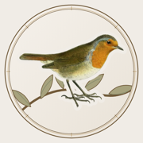
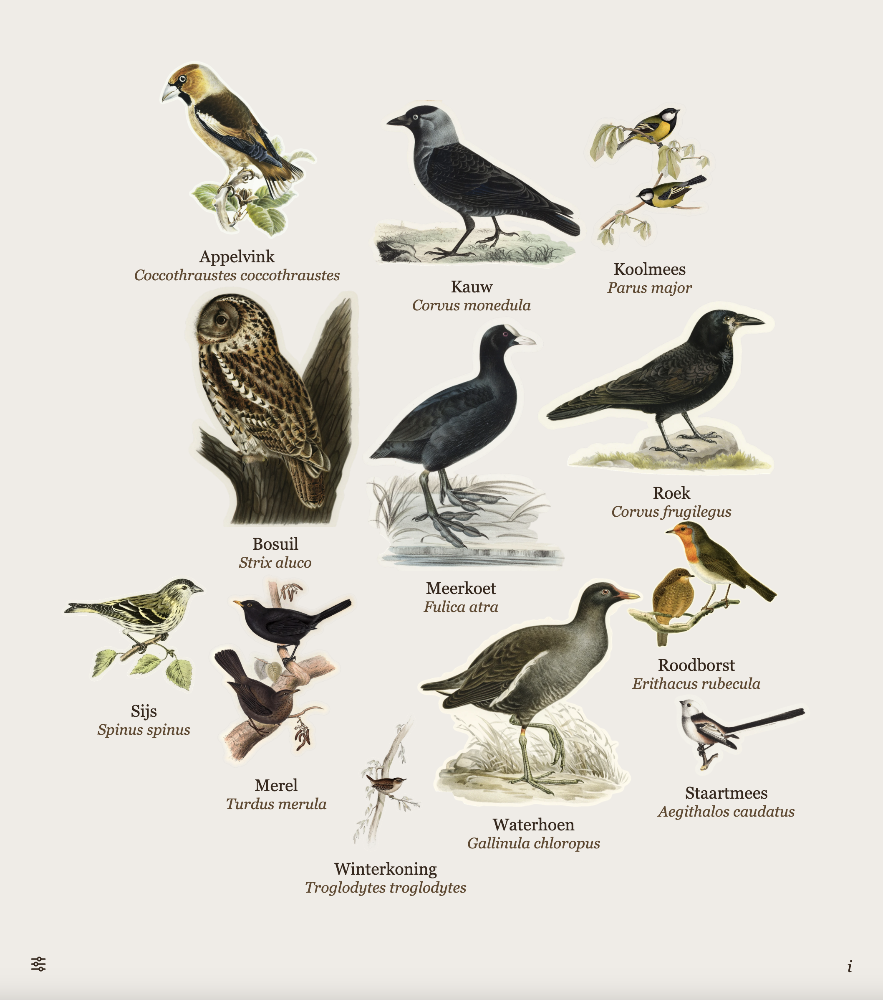
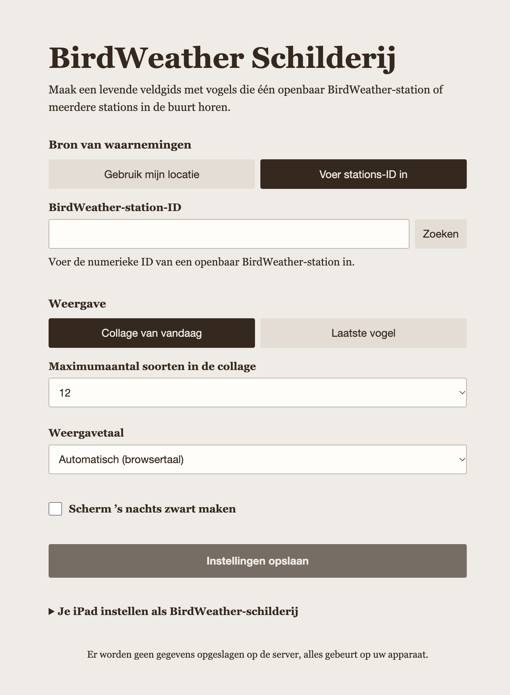
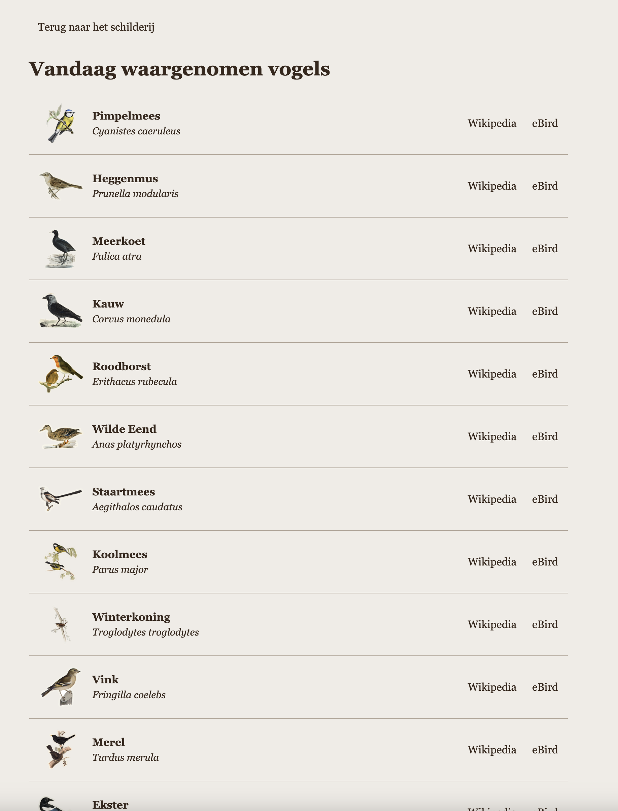

<h1 align="center">BirdWeather Painting</h1>

<p align="center">
  
</p>

<p align="center">A static, account-free bird display that turns recent observations from public BirdWeather stations into a natural-history painting for a wall-mounted tablet.</p>

<p align="center">
  
  
  <a href="LICENSE"></a>
</p>

<p align="center">
  
</p>

<p align="center">
  <a href="#getting-started">Getting started</a> · <a href="#features">Features</a> · <a href="#settings-and-urls">Settings and URLs</a> · <a href="#install-on-an-ipad">Install on an iPad</a> · <a href="#artwork">Artwork</a> · <a href="#privacy-and-network-use">Privacy</a>
</p>

## Getting started

Go to [florisvandesande.com/birds/](https://florisvandesande.github.io/BirdWeatherPainting/) on any device, give it your location, save, and start enjoying the birds around you.

Alternatively you can pick a station from [birdweather.com](https://app.birdweather.com/), input it in the search field and just see birds from that station.

## Features

- Show the latest detected species or a collage of unique species heard today.
- Choose one public station by numeric ID, or search stations near a location within a 2, 5, or 10 km radius.
- Show between 1 and 32 species in a collage. The default is 12. A newly heard species replaces the oldest species when the collage reaches its limit.
- Keep the collage composition stable while its species list stays the same. When the list changes, the birds are composed again, with larger birds near the centre and compact, irregular spacing.
- Show complete bird illustrations without cropping. Birds may overlap only where their image pixels are transparent.
- Use locally stored bird illustrations and perches. A missing bird illustration, an empty day, or a loading state uses a local perch.
- Show each bird's common name in the selected language and its scientific name. The artwork information page lists all unique species heard today and includes BirdWeather-provided Wikipedia summaries and available eBird and Wikipedia links.
- Choose English, Dutch, French, German, Spanish, Italian, or Brazilian Portuguese. Automatic language follows the browser language.
- Optionally turn the screen black on a local night schedule. Observation polling pauses while the display is black.

## Screenshots

<p align="center">
  
</p>

<p align="center">
  
</p>

## Settings and URLs

Settings are stored in the URL, not in browser storage. The base URL opens settings with nearby stations, a 2 km radius, today's collage, 12 species, automatic language, and night mode disabled. The nearby coordinates start blank until you use the location button or enter them.

A station URL has this form:

```text
?source=station&station=7368&view=today&limit=12&lang=auto&night=0&nightStart=22%3A00&nightEnd=07%3A00
```

A nearby-stations URL has this form:

```text
?source=nearby&lat=52.12345&lon=5.12345&radius=2&view=today&limit=12&lang=nl&night=1&nightStart=22%3A00&nightEnd=07%3A00
```

The supported query settings are:

- `source=station` with a public numeric `station` ID, or `source=nearby` with `lat`, `lon`, and a `radius` of `2`, `5`, or `10` kilometres;
- `view=today` for the collage or `view=latest` for one latest bird;
- `limit=1` through `limit=32` for the collage (default `12`); latest-bird mode always displays one bird;
- `lang=auto`, `en`, `nl`, `fr`, `de`, `es`, `it`, or `pt-BR`;
- `night=0` or `night=1`, plus `nightStart` and `nightEnd` in 24-hour `HH:MM` format. The time values remain in the URL even when night mode is disabled.

Saving settings writes the complete canonical URL. A partial or invalid link opens settings and keeps valid values prefilled. If `source` is missing from a partial link, nearby is selected; an explicitly invalid source remains unselected. Unknown query fields are ignored, and duplicate known fields are treated as invalid. Nearby coordinates are rounded to five decimal places. Night times use the device's local clock.

## Install on an iPad

Open its URL in Safari on the iPad, tap **Share**, then choose **Add to Home Screen**. In the iPad's Settings app, open **General → Auto-Lock** and choose **Never**; keep the iPad connected to power while it displays the painting.

## GitHub Pages deployment

The Pages workflow publishes the static app from `main`. It prepares a smaller
site artifact by compressing the artwork as indexed PNG while preserving
transparency; this keeps compatibility with older iPads, including iPad 2. The
original PNGs in the repository are left unchanged. In the repository's Pages
settings, select **GitHub Actions** as the build and deployment source.


## Set as macOS desktop background

Using an app like [Plash](https://sindresorhus.com/plash) you can set the site as your desktop background and enjoy the birds around.

## Artwork

The bird and perch illustrations come from Fugleramme. The adapted PNG images are available under CC BY-SA 4.0. The artwork information page links to the Fugleramme attribution ledger and licence. See [artwork sources and reuse](docs/artwork.md) and the [Fugleramme attribution ledger](https://github.com/arnegiacomo/fugleramme/blob/main/assets/artwork/classic/ATTRIBUTION.md).

The app icon uses the local robin illustration and is covered by the same artwork attribution. `assets/app-icon.svg` is its editable source; `assets/apple-touch-icon.png` is the 180 × 180 iPad home-screen image.

## Privacy and network use

The app has no project server and does not use application-owned browser storage. Settings are visible in the URL, browser history, and bookmarks. Nearby coordinates are included in that URL, and BirdWeather receives the nearby search area through its public GraphQL API. The app needs internet access for observations. A static host may record visitor IP addresses for routine security and operations. Settings saved by earlier versions are ignored.

## License

The application source code is available under the [MIT License](LICENSE). Artwork has separate terms; see [artwork sources and reuse](docs/artwork.md).
